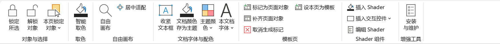
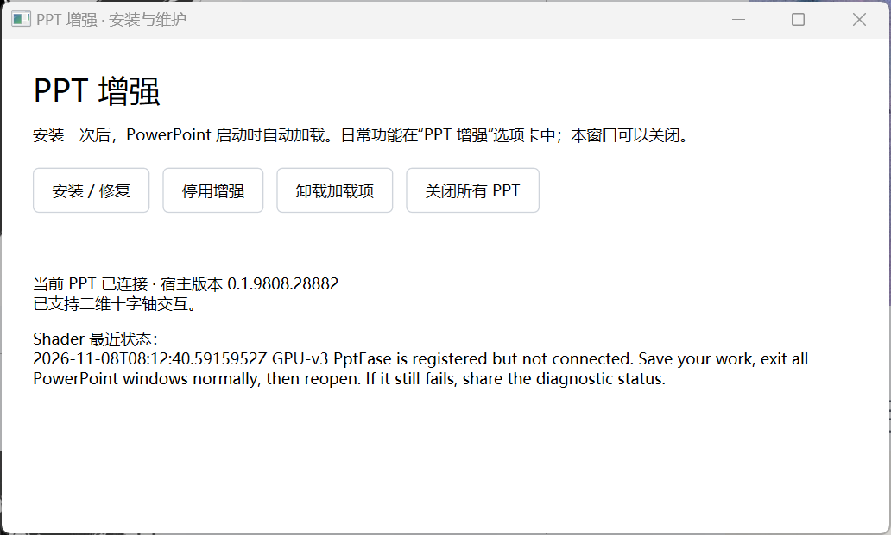
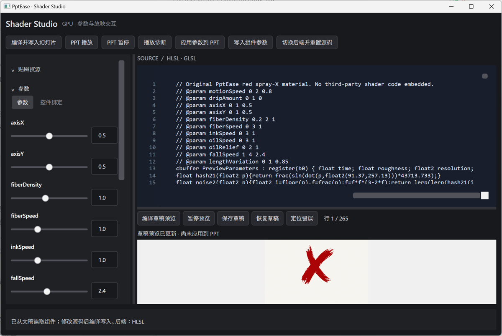
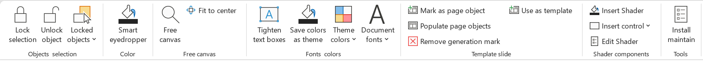
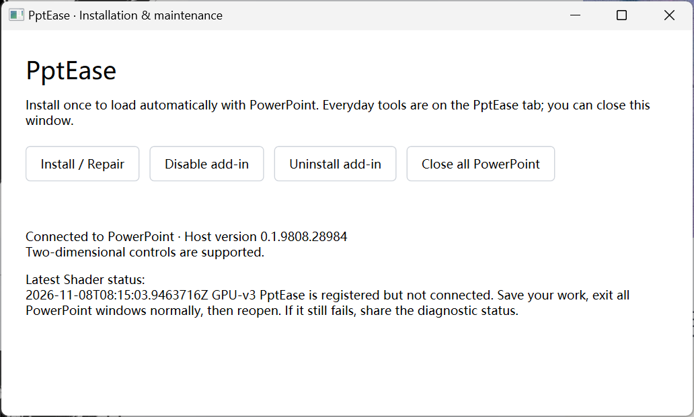
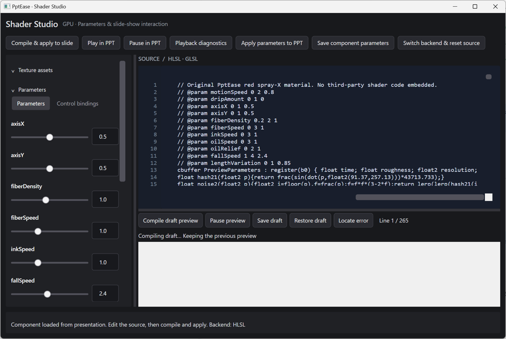

# PptEase

Windows PowerPoint 增强工具：排版辅助、原生取色、自由画布、GPU Shader 与放映交互控件。



<details>
<summary>中文界面截图：安装与维护、Shader Studio</summary>





</details>

[下载单页涂鸦交互示例](Samples/Graffiti/Graffiti-Sample.pptx?raw=true)：作者单独分享的个人作品，仅用于演示插件的 Shader 与交互控件能力，不属于 PptEase 插件功能或内置素材库。示例作品的权利归作者所有，公开展示不代表授权复制、改编或商用。

## 使用

下载 [单 EXE 发行版](https://github.com/dreamstring/PptEase/releases/latest)，运行 `PptEase-v0.1.1-win-x64-standalone.exe` → 安装 / 修复。保存文稿并重启 PowerPoint，打开“PPT 增强”。需要 Windows x64、64 位桌面 PowerPoint；GLSL 后端还需要 WebView2 Runtime。自包含包携带 .NET 9 运行时，但不包含 Office。

## 构建

安装 .NET 9 SDK；Windows 自带的 .NET Framework 4.x 编译器用于 COM 宿主。

```powershell
./build.ps1
./Host/test-ribbon.ps1
```

输出 `publish/PptEase.exe`。源码与发行包是同一工程，没有另一套 standalone 源码。

## 功能与边界

- 文字/形状/线条上下文识别，调用 PowerPoint 原生吸管。
- 文本框收紧、本文档字体、文档颜色写入主题、实时模板样式。
- 母版/版式标记对象生成普通页面图形；目前限不透明纯色普通形状。
- 自由画布：原生内部接口配合输入接管；仅支持经过哈希校验的 Office 构建，极端边界与辅助线同步仍有限制。
- Shader Studio：HLSL / GLSL、草稿预览、贴图、参数、保存到 PPTX。
- 分组的滑块、圆盘、方形 X/Y、复选框；放映/预览时交互，编辑时可排版。不依赖 VBA / ActiveX。
- 用户已验证 Shader 编辑与放映播放、控件拖动；复杂遮挡/旋转/动画/多屏仍受限制，不宣称完全等价原生对象。
- 锁定与解锁入口保留；锁定对象点击穿透尚未完成。

## 文档

- [技术实现详解](docs/Architecture.md)
- [Shader Studio](docs/Shader-Studio.md)
- [交互控件](docs/Shape-Slider.md)

本仓库不包含 Office 二进制、本机日志、旧测试输出或凭据。插件源码采用 [GPL-3.0-only](LICENSE)。Samples 中作者个人作品保留其单独声明的权利，不适用插件源码许可证。

## 界面语言

支持中文和英文，随 PowerPoint 的显示语言启动；其他语言暂回退英文。功能区、动态菜单、管理器、Shader Studio 和操作提示共用语言资源。独立启动时优先读取已加载的 PPT 宿主，其次读取 Office 语言设置，最后使用系统界面语言。切换 Office 显示语言后，请重启 PPT 和独立窗口。

文稿内容、字体名称、Shader 源码及参数标识不会翻译。所有 Markdown 文档按中文在前、英文在后排列。开发测试可用环境变量 `PPTEASE_UI_LANGUAGE=zh-CN` 或 `en` 指定界面语言。

---

# English



<details>
<summary>English screenshots: Installation & maintenance, Shader Studio</summary>





</details>

PptEase enhances Windows PowerPoint with layout tools, the native eyedropper, a free-canvas mode, GPU shaders, and interactive slideshow controls.

[Download the single-slide graffiti sample](Samples/Graffiti/Graffiti-Sample.pptx?raw=true). This is the author's personal artwork, shared separately to demonstrate shader playback and controls. It is not a plugin feature or built-in asset library. Rights remain with the author; public availability does not grant permission to copy, adapt, or use the artwork commercially.

## Usage

Download the [single EXE release](https://github.com/dreamstring/PptEase/releases/latest). Run `PptEase-v0.1.1-win-x64-standalone.exe`, choose Install / Repair (安装 / 修复), save your presentations, and restart PowerPoint. Open the PPT 增强 tab. Windows x64 and 64-bit desktop PowerPoint are required. The GLSL backend also requires WebView2 Runtime. The package includes the .NET 9 runtime, but not Office.

## Build

Install the .NET 9 SDK. The COM host uses the .NET Framework 4.x compiler supplied with Windows.

```powershell
./build.ps1
./Host/test-ribbon.ps1
```

The output is `publish/PptEase.exe`. Development builds and standalone releases use the same source project.

## Features and limitations

- Context-aware native eyedropper for text, shapes, and lines.
- Tighten text boxes, list document fonts, save document colors as theme colors, and read template styles dynamically.
- Generate ordinary slide shapes from marked master/layout objects. Currently limited to ordinary opaque, solid-color shapes.
- Free canvas uses internal Office interfaces and input handling. Only hash-verified Office builds are supported; extreme boundaries and guide synchronization remain limited.
- Shader Studio supports HLSL / GLSL, draft previews, textures, parameters, and persistence in PPTX.
- Grouped sliders, disks, square X/Y pads, and checkboxes are interactive during preview/slideshow and editable as layout objects otherwise. No VBA or ActiveX is required.
- Shader playback and control dragging have been manually verified. Complex occlusion, rotation, animation, and multiple displays remain limited; shader components are not fully equivalent to native objects.
- Lock/unlock commands remain available. Click-through selection of locked objects is not complete.

## Documentation

- [Architecture](docs/Architecture.md#english)
- [Shader Studio](docs/Shader-Studio.md#english)
- [Interactive controls](docs/Shape-Slider.md#english)

The repository excludes Office binaries, local logs, old test outputs, and credentials. Plugin source code is licensed under [GPL-3.0-only](LICENSE). Personal works in Samples retain their separately stated rights and are excluded from the plugin source license.

## Interface language

Chinese and English UI are supported. PptEase follows PowerPoint's display language at startup; other languages fall back to English. Ribbon commands, dynamic menus, the manager, Shader Studio and operation messages share the same resources. Standalone launches prefer the connected PPT host, then Office language settings, then the system UI language. Restart PowerPoint and standalone windows after changing Office's display language.

Presentation content, font names, Shader source and parameter identifiers are never translated. Markdown documentation is Chinese first, followed by English. For development testing, set `PPTEASE_UI_LANGUAGE` to `zh-CN` or `en`.

单 EXE 构建：`./build-standalone.ps1`。首次运行自动解包到本机应用数据目录，无需手动解压；仍需安装 PowerPoint，GLSL 需要 WebView2 Runtime。

Single EXE build: `./build-standalone.ps1`. First launch extracts the bundled application into local application data automatically. PowerPoint is required; GLSL requires WebView2 Runtime.
