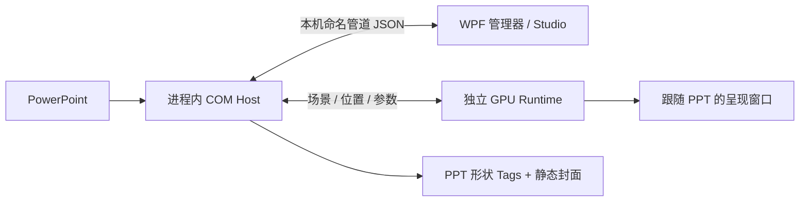

# PptEase 技术实现详解

## 1. 三个执行部分

PptEase 是 C# 桌面应用与 PowerPoint COM 加载项的组合。管理器和 Shader Studio 使用 .NET 9 WPF；PowerPoint 进程内的宿主使用 .NET Framework 4.x、x64 COM。GPU 播放器是同一个 EXE 的 `--shader-runtime <PPT进程号>` 模式，独立进程运行。

COM 宿主负责理解文稿和执行 Office 操作；WPF 负责编辑和安装；GPU 进程负责渲染。Shader 并没有成为 PowerPoint 内部的一种新原生 Shape。

## 2. 安装与启动

`App/IntegrationInstaller.cs` 注册 COM 类和 PowerPoint 加载项，`MaintenanceDeployment.cs` 按关键文件 SHA-256 标识，把程序部署到用户 LocalAppData 的版本目录。安装器校验复制结果；PowerPoint 下次启动加载宿主。旧宿主已在进程内时，需要保存并正常重启 PPT 才能完整换版。

`build.ps1` 先用 Framework csc 编译宿主，再 `dotnet publish -r win-x64 --self-contained true` 发布 WPF。standalone 表示携带 .NET 运行时的完整文件夹，不是只拷一个 EXE；Office、GPU 驱动和 GLSL 所需 WebView2 仍是外部依赖。

## 3. 功能区与通信

`Host/Connect.cs` 实现 COM 连接与 Ribbon XML 回调。Office 通过 `imageMso` 绘制原生图标，避免低分辨率位图在高 DPI 下变糊；`RibbonIcons.cs` 为主功能区及动态菜单补齐图标。主题色菜单例外：通过 `GetThemeColorImage` 生成对应颜色的小色块。

每个 PPT 进程有 `PptEase-<PID>` 命名管道。请求是包含 id、op、payload 的逐行 JSON，响应带相同 id、ok、result/error。管道 ACL 只允许当前 Windows 用户；宿主将 COM 操作调回 STA 线程，不让渲染线程直接并发操纵 Office。`App/HostClient.cs` 负责连接、超时及响应校验。

## 4. 排版工具

**智能取色**：识别文本选区、文本框、普通图形和线条，通过 CommandBars.ExecuteMso 调用匹配的 PowerPoint 原生吸管命令。没有自己截图逐像素取色，因此操作习惯仍来自 Office。

**文本框收紧**：读取 TextFrame2 的换行、自动适配、尺寸和位置；单行收紧宽高，多行保留排版宽度，调整框而不缩小字号；保留用于异常恢复的旧状态。

**字体与配色**：遍历文稿内容收集字体和颜色；主题色提取包含文字、形状与渐变色标，映射到 Office 的 12 个主题槽位。主题槽位数量有限，不是无限色板。应用时识别当前文字/形状选区。

**实时模板页**：文稿 Tags 保存模板 SlideID。打开菜单时重新读取源对象，应用时通过 Office 格式复制接口获取源样式，所以修改模板页后能反映出来。模板指定是文稿内状态，与“本文档字体/主题颜色”独立。

**母版前景图形**：给母版/版式对象加生成标记；创建页面或手动补齐时，新建普通页面 Shape 并复制格式。来源标记用于去重。这解决受支持对象的母版图形不能盖住页面图片的问题，没有修改 PowerPoint 的全局渲染顺序。当前只接受不透明纯色、无阴影、无文字的普通形状。

**锁定**：维护锁定/解锁命令与本页列表，切页更新上下文。用户要求的“左键穿透锁定对象”还未完整实现，不能把有按钮当成功能完全完成。

## 5. 自由画布

`NativeCanvas.cs` 对指定 ppcore.dll 的哈希及入口字节进行校验，调用内部画布视图/原点接口。`CanvasInput.cs` 接管相应拖动、滚轮与缩放输入，`CanvasFeature.cs` 管理开关。这里才包含与 Office 私有实现相关的部分。

它不是通用 Office API：升级 Office 后哈希不同会拒绝启用，需重新验证适配。原生渲染器的极端越界、裁剪与辅助线同步限制仍存在。不能把它宣传为所有版本无限画布。

## 6. Shader 文档格式

插入 Shader 时，PPT 保留一个原生静态封面，完整组件数据写在形状 Tags 中。`Shared/ShaderComponent.cs` 描述后端、源码、参数、纹理、输出尺寸、FPS、重新进入策略和控件绑定。

`ShaderPayload.cs` 将 JSON UTF-8 压缩为 Deflate，再转为十六进制、按 200 字符分块。原因是 Office Tags 可能改变大小写，直接存 Base64/源码不可靠。Manifest 包含代次、块数、SHA-256；先写块并回读，再发布 manifest，失败时保留旧记录。未压缩载荷上限 4 MiB。

没有安装 PptEase 的电脑只能看到封面；动态渲染依赖本机运行时。PPTX 本身不需要宏。BOM 在生成器和 HLSL 编译入口处理，避免拼接头文件后出现非法字符。

## 7. GPU 渲染

**HLSL**：`D3DShaderRenderer.cs` 编译 ps_5_0，使用 Direct3D 11。硬件设备用于实时呈现，WARP 是兼容/测试路径。时间、分辨率与自定义 float 参数通过常量缓冲区更新，纹理绑定到采样资源。参数变化不重新编译 Shader。

**GLSL**：`WebGlFrameRenderer.cs` 与 `preview.html` 通过 WebView2 / WebGL 执行 GLSL ES。它是另一条后端，不能认为所有 HLSL 语法或性能特征会自动等价转换。

**原位显示**：`GpuSurfaceWindow.cs` 创建跟随 PPT 所属窗口的 Win32 表面；画面窗口不激活、不抢输入。HLSL 实时显示走 GPU 呈现，封面生成/部分预览才需要像素回读。它不是每帧把截图贴回幻灯片，因此不会不断修改文稿。

**场景调度**：`GpuShaderRuntimeWindow.cs` 查询当前文稿/页面/放映上下文、位置与参数；活动场景约 50ms 查询，无场景约 150ms。编译初始化异步进行，同页编辑/放映可复用资源，真实换页释放表面；过期异步结果不能重新显示旧页。暂停放映的可见页面仍可交互；黑屏/白屏/结束状态不按普通播放处理。

**边界**：复杂前景遮挡、旋转、组合或对象动画可能回退封面。覆盖窗口无法无条件参加 PPT 内部的任意对象混合与转场。这是架构限制，需要逐类适配。

## 8. 交互控件

插入时创建带样式的普通 PowerPoint 形状并组合，便于编辑模式整体移动缩放。绑定记录目标组件及轨道/游标 ShapeId；滑块/复选框绑定一个参数，圆盘/方形绑定 X/Y 两个参数。

预览/放映时 `ShapeSliderWindow.cs` 在控件区域提供交互层。滑块把位置归一化后映射到参数范围；方形分别映射 X/Y；圆盘限制到圆内；复选框切换两端值。数值框显示一位小数并接受反向输入。图形表示与运行时输入分离，因此编辑模式仍能排版。

交互值先更新 GPU，再合并发送宿主；短期 overrides 防止旧轮询值覆盖刚拖出的值。场景、组件修订号和目标引用被再次检查，避免换页后迟到的回调污染新页。运行时和原生静态游标必须协调隐藏/恢复，否则会留下“双游标”；输入捕获、输入框提交与绘制比例也要分开处理。这些是此前拖不动、残留与压扁问题的来源，不是 Shader 本身的问题。

## 9. Shader Studio

WPF 编辑器包含源码、贴图、声明参数、控件绑定和保持宽高比的草稿预览。`// @param name min max default` 驱动参数界面，HLSL 自定义参数由后端补入。草稿预览与写入 PPT 分离；写入是明确动作，避免临时修改立即污染文稿。纹理随组件保存。样式由 `StudioTheme.cs` 管理。

## 10. 源码阅读顺序

1. `App/App.xaml.cs`：启动模式。
2. `Host/Connect.cs`：Office 生命周期、Ribbon、管道。
3. `Host/ShaderComponents.cs` 与 `ShaderPlacement.cs`：文稿组件及放置约束。
4. `Shared/ShaderComponent.cs` / `ShaderPayload.cs`：持久化协议。
5. `App/Shader/GpuShaderRuntimeWindow.cs`：生命周期。
6. `D3DShaderRenderer.cs` / `GpuSurfaceWindow.cs`：编译与呈现。
7. `ShapeSliderWindow.cs`：控件交互。
8. `ShaderComponentWindow.cs`：编辑器。

## 11. 发布验证

源码、standalone 包、演示文件应分别保存。构建与 Ribbon XML/回调测试能检查图标声明和接口，不等于验证每个 Office 版本真实绘制。手工测试仍应覆盖切页返回、退出放映、保存重开、数值框输入后拖动、DPI/多屏、Office 版本变化。

---

# English

## 1. Three execution components

PptEase combines a C# desktop application with a PowerPoint COM add-in. The manager and Shader Studio use .NET 9 WPF. The x64 COM host runs inside PowerPoint on .NET Framework 4.x. The GPU player is a separate process launched from the same executable with `--shader-runtime <PowerPoint PID>`.

The COM host interprets presentations and performs Office operations. WPF provides editing and installation. The GPU process renders shaders to presentation windows. A shader is not a new native PowerPoint Shape type. The diagram in the Chinese section shows these components and their connections.

## 2. Installation and startup

`App/IntegrationInstaller.cs` registers the COM class and PowerPoint add-in. `MaintenanceDeployment.cs` identifies deployments by SHA-256 hashes of key files and copies the application to a versioned directory under the user's LocalAppData. The installer verifies the copies. PowerPoint loads the host at its next startup; an already loaded host requires saving presentations and restarting PowerPoint to complete an upgrade.

`build.ps1` compiles the host with the Framework compiler, then publishes WPF with `dotnet publish -r win-x64 --self-contained true`. Standalone means a complete folder containing the .NET runtime, not a single executable. Office, GPU drivers, and WebView2 for GLSL remain external dependencies.

## 3. Ribbon and communication

`Host/Connect.cs` implements COM connection and Ribbon XML callbacks. Office draws native icons through `imageMso`, avoiding blurry low-resolution images at high DPI. `RibbonIcons.cs` supplies icons for the ribbon and dynamic menus. Theme colors use generated swatches through `GetThemeColorImage` instead.

Each PowerPoint process has a `PptEase-<PID>` named pipe. Requests use newline-delimited JSON with id, op, and payload; responses carry the matching id, ok, and result/error. The pipe ACL allows only the current Windows user. The host dispatches COM operations to the STA thread rather than accessing Office concurrently from rendering threads. `App/HostClient.cs` handles connections, timeouts, and response validation.

## 4. Layout tools

**Smart eyedropper:** detects text selections, text boxes, ordinary shapes, and lines, then invokes the matching native PowerPoint command through CommandBars.ExecuteMso. It does not implement screen-pixel sampling itself.

**Tighten text boxes:** reads TextFrame2 wrapping, autofit, size, and position. Single-line boxes shrink in both dimensions; multiline boxes retain their layout width. It changes the box rather than reducing the font size, and retains previous state for error recovery.

**Fonts and colors:** traverses document content to collect fonts and colors. Theme extraction includes text, shapes, and gradient stops and maps them to Office's 12 theme slots. This is not an unlimited palette. Applying a color respects the current text or shape selection.

**Live template slide:** stores a template SlideID in presentation Tags. Menus reread source objects when opened; applying a style uses Office formatting-copy interfaces. Changes to the source slide can therefore be reflected. Template selection is document state, separate from document fonts and theme colors.

**Master foreground objects:** marked master/layout objects generate ordinary slide shapes on slide creation or through an explicit completion command. Source markers prevent duplication. This lets supported master artwork cover slide pictures without changing PowerPoint's global rendering order. Currently restricted to ordinary opaque, solid-color shapes without shadows or text.

**Locking:** maintains lock/unlock commands and the current-slide list, refreshing context on slide changes. Left-click pass-through of locked objects is not fully implemented; the presence of a button does not imply the behavior is complete.

## 5. Free canvas

`NativeCanvas.cs` checks a specific ppcore.dll hash and entry bytes before calling internal canvas view/origin interfaces. `CanvasInput.cs` handles the corresponding drag, wheel, and zoom input; `CanvasFeature.cs` manages the toggle. This part depends on private Office implementation details.

These are not general Office APIs. A different hash after an Office update prevents activation until compatibility is verified again. Native rendering limitations around extreme panning, clipping, and guide synchronization remain. This is not an unlimited canvas for every Office version.

## 6. Shader document format

Inserting a shader leaves a native static cover in PowerPoint and writes complete component data to shape Tags. `Shared/ShaderComponent.cs` describes the backend, source, parameters, textures, output size, FPS, re-entry policy, and control bindings.

`ShaderPayload.cs` compresses UTF-8 JSON with Deflate, converts it to hexadecimal, and splits it into 200-character chunks. Office Tags can change letter case, making direct Base64 or source storage unreliable. The manifest contains a generation identifier, chunk count, and SHA-256. Chunks are written and read back before publishing the manifest; failure retains the previous record. The uncompressed payload limit is 4 MiB.

Computers without PptEase show only the cover. Dynamic rendering depends on the local runtime, but the PPTX requires no macros. BOM handling in the generator and HLSL compilation entry point prevents invalid characters after generated headers are prepended.

## 7. GPU rendering

**HLSL:** `D3DShaderRenderer.cs` compiles ps_5_0 and uses Direct3D 11. Hardware devices provide real-time rendering; WARP is a compatibility/test path. Time, resolution, and custom float parameters are updated through constant buffers; textures are bound as shader resources. Parameter changes do not recompile the shader.

**GLSL:** `WebGlFrameRenderer.cs` and `preview.html` execute GLSL ES through WebView2/WebGL. This is a separate backend; HLSL syntax and performance characteristics do not automatically carry over.

**In-place display:** `GpuSurfaceWindow.cs` creates a Win32 surface that follows the owning PowerPoint window without activation or input capture. HLSL playback uses GPU presentation; cover generation and some previews require pixel readback. Frames are not repeatedly pasted into the slide, so playback does not continually modify the document.

**Scene scheduling:** `GpuShaderRuntimeWindow.cs` queries document, slide/slideshow context, placement, and parameters approximately every 50 ms for active scenes and 150 ms without a scene. Compilation and initialization run asynchronously. Editing and slideshow on the same slide can reuse resources; actual slide changes release surfaces. Stale asynchronous results cannot restore an old slide. Visible paused slides remain interactive; black, white, and ended slideshow states are handled separately.

**Limitations:** complex foreground occlusion, rotation, grouping, or object animation may fall back to the cover. Overlay windows cannot participate unconditionally in arbitrary PowerPoint object compositing and transitions. These are architectural limits requiring individual adaptations.

## 8. Interactive controls

Insertion creates styled ordinary PowerPoint shapes and groups them for movement and resizing in edit mode. Bindings record the target component and track/handle ShapeIds. Sliders and checkboxes bind one parameter; disks and square pads bind X/Y parameters.

During preview/slideshow, `ShapeSliderWindow.cs` supplies an interaction layer. Sliders map normalized position to a parameter range. Square pads map X/Y independently; disks constrain the position to a circle; checkboxes toggle between two values. Numeric fields display one decimal place and accept input. Separating the document shapes from runtime input preserves normal layout editing.

Interaction values update the GPU first, then are coalesced and sent to the host. Short-lived overrides prevent stale polling results from overwriting a recent drag. Scene, component revision, and target references are checked again so delayed callbacks cannot affect a new slide. Runtime and static handles must coordinate hiding/restoration to avoid duplicate handles. Input capture, numeric-field commits, and display scaling are handled separately; earlier dragging, residual-handle, and distortion defects originated here rather than in the shader itself.

## 9. Shader Studio

The WPF editor includes source, textures, declared parameters, bindings, and an aspect-ratio-preserving draft preview. `// @param name min max default` drives the parameter UI, and the backend supplies custom HLSL parameter declarations. Draft previews are separate from writing to PowerPoint. Writing is explicit so temporary edits do not immediately change the document. Textures are stored with the component. `StudioTheme.cs` manages styling.

## 10. Suggested source reading order

1. `App/App.xaml.cs`: startup modes.
2. `Host/Connect.cs`: Office lifecycle, ribbon, and pipe.
3. `Host/ShaderComponents.cs` and `ShaderPlacement.cs`: document components and placement constraints.
4. `Shared/ShaderComponent.cs` and `ShaderPayload.cs`: persistence protocol.
5. `App/Shader/GpuShaderRuntimeWindow.cs`: runtime lifecycle.
6. `D3DShaderRenderer.cs` and `GpuSurfaceWindow.cs`: compilation and presentation.
7. `ShapeSliderWindow.cs`: control interaction.
8. `ShaderComponentWindow.cs`: editor.

## 11. Release validation

Keep source, standalone packages, and demonstration files separate. Build and Ribbon XML/callback tests validate declarations and interfaces, not actual rendering across all Office versions. Manual tests should cover leaving and returning to a slide, exiting slideshow, saving/reopening, dragging after numeric input, DPI/multiple displays, and Office version changes.
